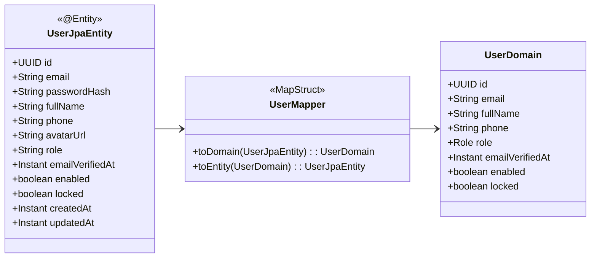

# Data Model: Foundation Setup for Ellora Backend Refactor

**Feature**: `specs/eddie-001-foundation-setup` | **Date**: 2026-11-06

---

## 1. Domain Model vs JPA Entity Separation

Under Clean Architecture L2, persistence details are isolated in `ellora-infrastructure`, while pure domain logic resides in `ellora-domain`.

---

## 2. Baseline Database Schema (21 Core Relational Tables)

The baseline migration `V1__baseline_schema.sql` establishes the existing database schema without ORM auto-generation:

### 2.1 Identity & Access
1. **`users`** (renamed from `profiles` in P1, baseline includes existing profile fields + auth extensions):
   - `id` (UUID, PK)
   - `email` (VARCHAR(255), UNIQUE, NOT NULL)
   - `password_hash` (VARCHAR(255))
   - `full_name` (VARCHAR(150))
   - `phone` (VARCHAR(20))
   - `avatar_url` (VARCHAR(500))
   - `role` (VARCHAR(30), NOT NULL - `CUSTOMER`, `SALON_OWNER`, `STAFF`, `ADMIN`)
   - `email_verified_at` (TIMESTAMPTZ)
   - `enabled` (BOOLEAN, DEFAULT true)
   - `locked` (BOOLEAN, DEFAULT false)
   - `created_at` (TIMESTAMPTZ, DEFAULT NOW())
   - `updated_at` (TIMESTAMPTZ, DEFAULT NOW())
2. **`revoked_access_tokens`**:
   - `token_hash` (VARCHAR(255), PK)
   - `expires_at` (TIMESTAMPTZ, NOT NULL)
3. **`refresh_tokens`** (Phase P1 addition schema prepared):
   - `id` (UUID, PK)
   - `user_id` (UUID, FK -> users.id)
   - `token_hash` (VARCHAR(255), UNIQUE, NOT NULL)
   - `family_id` (UUID, NOT NULL)
   - `expires_at` (TIMESTAMPTZ, NOT NULL)
   - `revoked_at` (TIMESTAMPTZ)
   - `replaced_by_id` (UUID)
   - `created_at` (TIMESTAMPTZ, DEFAULT NOW())

### 2.2 Salon Management
4. **`salons`**:
   - `id` (UUID, PK)
   - `owner_id` (UUID, FK -> users.id, NOT NULL)
   - `name` (VARCHAR(255), NOT NULL)
   - `address` (TEXT, NOT NULL)
   - `city` (VARCHAR(100), NOT NULL)
   - `phone` (VARCHAR(20))
   - `description` (TEXT)
   - `status` (VARCHAR(30) - `PENDING`, `APPROVED`, `SUSPENDED`)
   - `rating_average` (NUMERIC(3,2), DEFAULT 0.0)
   - `review_count` (INT, DEFAULT 0)
   - `created_at`, `updated_at` (TIMESTAMPTZ)
5. **`salon_photos`**:
   - `id` (UUID, PK), `salon_id` (UUID, FK), `photo_url` (VARCHAR(500)), `is_primary` (BOOLEAN), `created_at`
6. **`salon_working_hours`**:
   - `id` (UUID, PK), `salon_id` (UUID, FK), `day_of_week` (INT), `open_time` (TIME), `close_time` (TIME), `is_closed` (BOOLEAN)
7. **`salon_closures`**:
   - `id` (UUID, PK), `salon_id` (UUID, FK), `start_date` (DATE), `end_date` (DATE), `reason` (VARCHAR(255))
8. **`service_categories`**:
   - `id` (UUID, PK), `salon_id` (UUID, FK), `name` (VARCHAR(100)), `display_order` (INT)
9. **`services`**:
   - `id` (UUID, PK), `salon_id` (UUID, FK), `category_id` (UUID, FK), `name` (VARCHAR(255)), `price` (NUMERIC(12,2)), `duration_minutes` (INT), `status` (VARCHAR(30))
10. **`staff`**:
    - `id` (UUID, PK), `salon_id` (UUID, FK), `name` (VARCHAR(150)), `phone` (VARCHAR(20)), `role_title` (VARCHAR(100)), `is_active` (BOOLEAN)
11. **`staff_services`**:
    - `staff_id` (UUID, FK), `service_id` (UUID, FK), PRIMARY KEY (staff_id, service_id)
12. **`staff_working_hours`**:
    - `id` (UUID, PK), `staff_id` (UUID, FK), `day_of_week` (INT), `start_time` (TIME), `end_time` (TIME)

### 2.3 Booking & Appointments
13. **`bookings`**:
    - `id` (UUID, PK)
    - `booking_code` (VARCHAR(30), UNIQUE, NOT NULL)
    - `salon_id` (UUID, FK -> salons.id)
    - `customer_id` (UUID, FK -> users.id, NULLABLE for guests)
    - `guest_name` (VARCHAR(150))
    - `guest_phone` (VARCHAR(20))
    - `guest_email` (VARCHAR(255))
    - `booking_time` (TIMESTAMPTZ, NOT NULL)
    - `total_price` (NUMERIC(12,2), NOT NULL)
    - `status` (VARCHAR(30) - `PENDING`, `CONFIRMED`, `COMPLETED`, `CANCELLED`, `DISPUTED`)
    - `completion_status` (VARCHAR(30))
    - `is_walk_in` (BOOLEAN, DEFAULT false)
    - `notes` (TEXT)
    - `created_at`, `updated_at` (TIMESTAMPTZ)
14. **`booking_items`**:
    - `id` (UUID, PK), `booking_id` (UUID, FK), `service_id` (UUID, FK), `staff_id` (UUID, FK), `price` (NUMERIC(12,2)), `duration_minutes` (INT)
15. **`booking_history`**:
    - `id` (UUID, PK), `booking_id` (UUID, FK), `status_from` (VARCHAR(30)), `status_to` (VARCHAR(30)), `changed_by` (UUID), `note` (TEXT), `created_at` (TIMESTAMPTZ)
16. **`reviews`**:
    - `id` (UUID, PK), `booking_id` (UUID, FK, UNIQUE), `salon_id` (UUID, FK), `customer_id` (UUID, FK), `rating` (INT), `comment` (TEXT), `created_at` (TIMESTAMPTZ)

### 2.4 Subscriptions & Financials
17. **`subscription_plans`**:
    - `id` (UUID, PK), `name` (VARCHAR(100)), `price` (NUMERIC(12,2)), `duration_days` (INT), `max_staff` (INT), `max_services` (INT), `features` (JSONB)
18. **`salon_subscriptions`**:
    - `id` (UUID, PK), `salon_id` (UUID, FK), `plan_id` (UUID, FK), `status` (VARCHAR(30) - `ACTIVE`, `EXPIRED`, `PENDING_REVIEW`), `start_date` (TIMESTAMPTZ), `end_date` (TIMESTAMPTZ)
19. **`subscription_bank_transfers`**:
    - `id` (UUID, PK), `subscription_id` (UUID, FK), `amount` (NUMERIC(12,2)), `transfer_code` (VARCHAR(50)), `proof_image_url` (VARCHAR(500)), `status` (VARCHAR(30)), `reviewed_by` (UUID), `created_at` (TIMESTAMPTZ)
20. **`platform_support_contacts`**:
    - `id` (UUID, PK), `contact_type` (VARCHAR(50)), `value` (VARCHAR(255)), `description` (TEXT), `is_active` (BOOLEAN)
21. **`revenue_records`**:
    - `id` (UUID, PK), `salon_id` (UUID, FK), `record_date` (DATE), `total_amount` (NUMERIC(14,2)), `booking_count` (INT), `created_at` (TIMESTAMPTZ)

---

## 3. Flyway Migration Versioning Policy

- All baseline tables, sequences, foreign keys, and indexes are defined in `V1__baseline_schema.sql`.
- Migration filenames strictly follow `V{version}__{description}.sql` (e.g., `V2__auth_self_managed_tables.sql` in P1).
- Applied migrations are immutable. Checksums are validated on container startup.
- Rollback or corrective migrations are executed as forward migrations (`V{n+1}__fix_...sql`).
